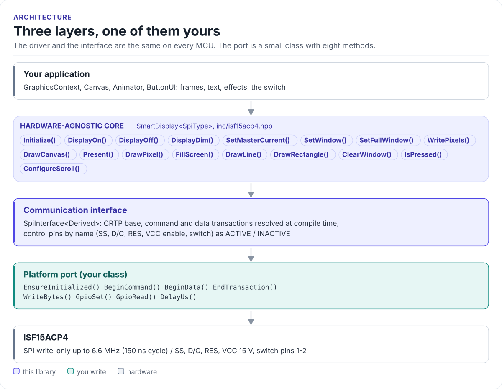

# ISF15ACP4 Driver

A C++20 driver for the NKK ISF15ACP4 SmartDisplay, a pushbutton with a 96 x 64 colour OLED: initialise it, draw
text, shapes, images and animations, and read the switch, from any MCU with SPI.

[](https://github.com/hardfoc/hf-isf15acp4-driver/actions/workflows/ci-host-tests.yml)
[](https://github.com/hardfoc/hf-isf15acp4-driver/actions/workflows/esp32-examples-build-ci.yml)
[](https://hardfoc.github.io/hf-isf15acp4-driver/)
[](LICENSE)

**Documentation: <https://hardfoc.github.io/hf-isf15acp4-driver/>**

<!-- figure: driver-layers -->
<picture>
  <source media="(prefers-color-scheme: dark)" srcset="docs/diagrams/driver-layers.dark.svg">
  
</picture>
<!-- /figure -->

## In 30 seconds

Write a small port class for your MCU (SPI write with D/C and SS, four control pins, the switch, a delay;
[Porting](https://hardfoc.github.io/hf-isf15acp4-driver/latest/porting/)), then:

<!-- generated: quickstart-code -->
```cpp
#include "isf15acp4.hpp"

int show_ready(MySpi& spi) {
  isf15acp4::SmartDisplay<MySpi> display(&spi);       // ISF15ACP4, software canvas

  if (!display.Initialize()) {                        // 1. reset, 15 V on, SSD1331 init table
    return -1;                                        // wiring, VCC or SPI: see GetLastError()
  }

  auto gfx = display.CreateGraphicsContext();         // 2. draw into a 96 x 64 RGB565 frame
  gfx.Clear(isf15acp4::colors::Black);
  gfx.DrawString(4, 4, "READY", isf15acp4::colors::Green);
  gfx.DrawRect({0, 0, 95, 63}, isf15acp4::colors::White);

  if (!display.Present(gfx)) {                        // 3. send the frame (12,288 bytes)
    return -2;
  }
  return display.IsPressed() ? 1 : 0;                 // 4. the switch, through your port
}
```
<!-- /generated -->

## What it does

- Resets the display, sequences its 15 V drive supply and sends the SSD1331 initialisation table
  (`Initialize()`).
- Draws into a 96 x 64 RGB565 canvas with lines, rectangles, a 5 x 7 font and images, and uploads it in one
  transaction (`Present()`).
- Runs the controller's own line, rectangle, clear and scroll commands, and sets brightness and dim mode.
- Times animations (`Animator`, four built-in effects) and debounces the switch into press, click and long-press
  events (`ButtonUI`).
- No heap, no exceptions, no RTOS, no virtual calls (the port is a CRTP class).

## Install

```bash
git submodule add https://github.com/hardfoc/hf-isf15acp4-driver.git external/hf-isf15acp4-driver
```

```cmake
add_subdirectory(external/hf-isf15acp4-driver)
target_link_libraries(my_app PRIVATE hf_isf15acp4)
```

ESP-IDF: use the component wrapper in [`examples/esp32/components/hf_isf15acp4`](examples/esp32/components/hf_isf15acp4/CMakeLists.txt).
Details: [Installation](https://hardfoc.github.io/hf-isf15acp4-driver/latest/installation/).

## Documentation

| | |
| --- | --- |
| [Quickstart](https://hardfoc.github.io/hf-isf15acp4-driver/latest/quickstart/) | Wire it, write the port, show text |
| [Hardware](https://hardfoc.github.io/hf-isf15acp4-driver/latest/hardware/) | Pins, supplies, SPI timing, power sequence |
| [API guide](https://hardfoc.github.io/hf-isf15acp4-driver/latest/api-guide/) | Initialise, draw, brightness, switch, errors |
| [Graphics](https://hardfoc.github.io/hf-isf15acp4-driver/latest/graphics/) | Backends, colours, text, images |
| [Examples](https://hardfoc.github.io/hf-isf15acp4-driver/latest/examples/) | ESP32 applications |
| [API reference](https://hardfoc.github.io/hf-isf15acp4-driver/latest/api/) | Doxygen, every class and member |

The pages are in [`docs/`](docs/index.md).

## Tests

```bash
cmake -S . -B build-host -DHF_ISF15ACP4_BUILD_TESTS=ON && cmake --build build-host && ctest --test-dir build-host
```

The host tests check the exact bytes and pin sequence the driver sends; the code on the documentation site is
compiled by the same build.

## License

GPL-3.0. See [LICENSE](LICENSE).
