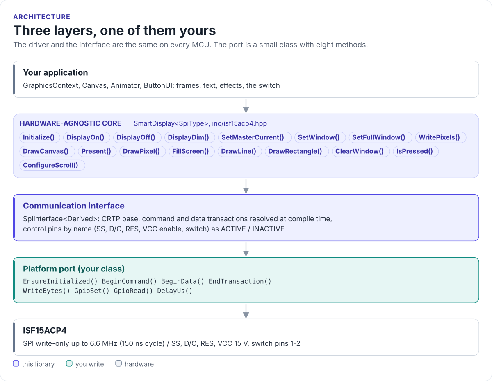
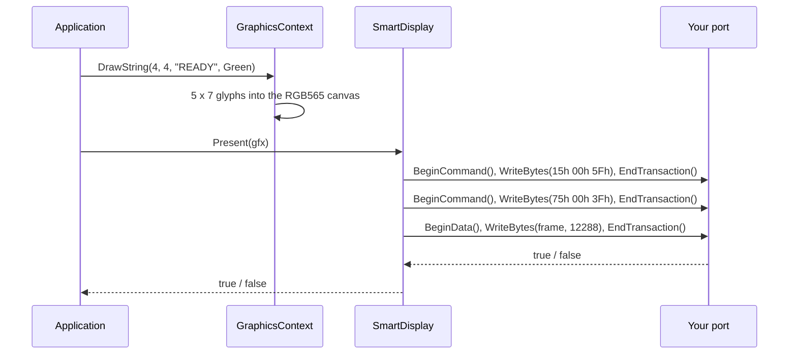

# Architecture

How the driver is put together: three layers, what each owns, and how one call reaches the display.

<!-- figure: driver-layers -->
<picture>
  <source media="(prefers-color-scheme: dark)" srcset="diagrams/driver-layers.dark.svg">
  
</picture>
<!-- /figure -->

## The three layers

| Layer | What | You change it |
| --- | --- | --- |
| Hardware-agnostic core | `SmartDisplay<SpiType>` and the graphics, animation and button helpers | Never |
| Communication interface | `SpiInterface<Derived>` | Never |
| Platform port | Your class | Once per MCU or board ([Porting](porting.md)) |

Everything above the port is the same on ESP32, STM32, a Linux host or the unit-test port. That is how the
[host tests](testing.md) run the real driver code without hardware.

## How one call reaches the display

## The pieces of the core

| Type | Owns |
| --- | --- |
| `SmartDisplay` | Reset and supply sequence, init table, windows, frame upload, hardware drawing, scroll, brightness, switch, errors |
| `GraphicsContext` | The drawing surface, with the backend chosen at construction |
| `Canvas` | A 96 x 64 RGB565 frame, software drawing, the 5 x 7 font |
| `Animator` | Frame timing; `animations::` holds four built-in effects |
| `ButtonUI` | Switch debouncing and events, status and gauge drawing |
| `ssd1331::` | Command opcodes, init tables, timing constants |
| Types | `SmartDisplayConfig`, `ProductVariant`, `Error`, `Rect`, `Point`, `Color565`, `colors::` |

## Why CRTP

The interface is a class template parameter, not a virtual base class. The compiler sees your port's methods
directly and inlines them; the driver has no vtable, allocates nothing and needs no RTTI. The cost is that the
driver type names the port: `SmartDisplay<MySpi>`. Code that works with several port types takes the driver as a
template parameter too.

`GraphicsContext` uses the same pattern (`GraphicsSurface<Derived>`) for its drawing calls. Its link back to the
display in hardware-direct mode is a small table of function pointers (`DisplayPresenter`), so the graphics code
does not depend on your port type.

## Memory

Nothing is allocated on the heap. The large objects are the frames:

| Object | Size |
| --- | --- |
| `Canvas` | 12,288 bytes (96 x 64 x 2), whatever the variant |
| `GraphicsContext` | One `Canvas` plus a few bytes, in every backend |
| `SmartDisplay` | A few dozen bytes; `FillScreen()` builds a temporary `Canvas` on the stack |

Keep a `GraphicsContext` as a static or long-lived object rather than on a small task stack, and give the task that
calls `FillScreen()` at least 13 KB of stack.

## Source map

Headers are in [`inc/`](../inc/isf15acp4.hpp) and their template bodies (`.ipp`) in [`src/`](../src/isf15acp4.ipp);
every file name starts with `isf15acp4`.

| File | Contents |
| --- | --- |
| `.hpp`, `.ipp` | `SmartDisplay<SpiType>` |
| `_spi_interface.hpp` | `SpiInterface`, `CtrlPin`, `GpioSignal` |
| `_graphics_*.hpp`, `_canvas.hpp` | Graphics backends, the canvas |
| `_animator.hpp`, `_button_ui.hpp` | Animation and switch helpers, `SmartDisplayConfig` |
| `_font.hpp`, `_font_data.cpp` | The 5 x 7 font: the one compiled source |
| `_ssd1331.hpp` | SSD1331 commands, init tables |
| `_types.hpp` | Types, colours, geometry |

`scripts/convert_image_to_rgb565.py` converts PNG artwork, `tests/` holds the host tests and the compiled
documentation snippets, and `examples/esp32/` the ESP-IDF applications.
