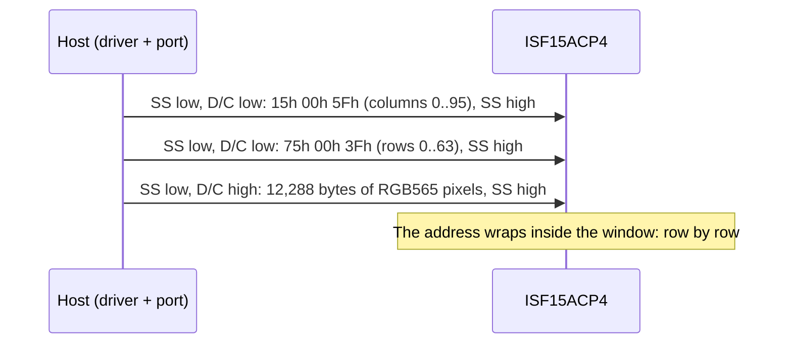

# Hardware

What to connect between your MCU and an ISF15ACP4, with which bus settings and supply sequence, and the limits to
stay inside.

All values here come from the NKK [Frameless OLED Pushbutton datasheet](https://www.nkkswitches.com/pdf/IS15ACP4_FramelessOLED.pdf)
(dated 10/03/19), and for the controller's command set from the Solomon Systech SSD1331 datasheet (Rev 1.2). When
they disagree with your board's schematic, the schematic wins for pin numbers and levels.

## Pins

Terminal numbers are not printed on the switch; take them from the footprint drawing in the datasheet.

| Pin | Signal | Function |
| --- | --- | --- |
| 1, 2 | SW | Switch contacts, normally open; closed while pressed |
| 3 | VDD | Logic supply, 2.4 V to 3.5 V |
| 4 | SS | SPI slave select, active low (input) |
| 5 | RES | Reset, active low (input); low initialises the controller |
| 6 | D/C | Low: the byte is a command; high: the byte is display data (input) |
| 7 | SCK | SPI clock (input) |
| 8 | SDI | SPI data in (input) |
| 9 | VCC | OLED drive supply, 14 V to 16 V |
| 10 | GND | Ground |

There is no data output: the display is written, never read. The switch is a separate contact pair; wire pin 1 to
an MCU input with a pull-up and pin 2 to ground, and a press reads low.

The driver names its control lines `isf15acp4::CtrlPin`: `ChipSelect`, `DataCommand`, `Reset`, `VccEnable` and
`Switch`. `VccEnable` is not a module pin: it is the enable input of the supply that makes VCC.

## Bus settings

| Setting | Value |
| --- | --- |
| Mode | SPI mode 0 (or 3): SDI is shifted in on the rising edge of SCK, MSB first |
| Clock | tcycle 150 ns minimum, so at most about 6.6 MHz; SCK high and low 75 ns minimum each |
| Frame | Bytes; D/C is sampled with the last bit of each byte |
| Chip select | SS setup 75 ns, SS hold 60 ns; keep SS low for a command and all its parameter bytes |
| D/C | Setup and hold 40 ns around the byte |
| Data setup, hold | 40 ns each |
| SCK rise, fall | 15 ns maximum |

The driver's constants are `ssd1331::kMaxSpiClockHz` (6,600,000) and `ssd1331::kResetPulseMinUs` (3). The ESP32
examples run at 6 MHz. Each driver call is one or more SS-low transactions: a command with its parameters
(D/C low), or a block of pixel data (D/C high).

## Power

| Parameter | VDD | VCC |
| --- | --- | --- |
| Range | 2.4 V to 3.5 V | 14.0 V to 16.0 V |
| Typical | 2.8 V | 15.0 V |
| Absolute maximum | 4.0 V | 19.0 V |
| All pixels on | 0.17 mA (0.20 max) | 11.0 mA (13.2 max) |
| Asleep | 10 µA max | 10 µA max |

VDD feeds the logic and VCC the OLED drive. Currents are at 25 °C, VDD = 2.8 V, VCC = 15 V.

Inputs swing from 0.2 x VDD (low, maximum) to 0.8 x VDD (high, minimum) and must stay within −0.3 V to
VDD + 0.3 V, so drive the module from MCU I/O at the same voltage as VDD.

### Power sequence

The datasheet's power on / off sequence:

1. Raise VDD with RES, SS, D/C, SCK and SDI low or high impedance.
2. Hold RES low for at least 3 µs, then release it.
3. Turn VCC on at least 3 µs later, then send the initialisation commands.
4. To power off, send display off (`AEh`), turn VCC off, then VDD (0 µs minimum between them).

While VCC is off it sits near VDD through the controller's ESD protection; that is expected.

`SmartDisplay::Initialize(true)` does steps 2 and 3: it drives `Reset` for 3 µs, sets `VccEnable` active, waits
1 ms and sends the initialisation table. With `Initialize(false)` it leaves VCC alone, for boards that switch the
supply themselves. The driver has no power-off call: send `DisplayOff()`, then drop `VccEnable` from your own code.

## Switch

| Parameter | Value |
| --- | --- |
| Circuit | SPST, normally open, momentary |
| Rating | 100 mA at 12 V DC, resistive |
| Contact resistance | 200 mΩ maximum |
| Operating force | 2.0 N ± 0.5 N; never more than 100 N on the keytop |
| Travel | 1.8 mm |
| Endurance | 1,000,000 operations, mechanical and electrical |

The contacts bounce like any switch. `ButtonUI` debounces them ([API guide](api-guide.md#read-the-switch)).

## Display

| Parameter | Value |
| --- | --- |
| Pixels | 96 x 64 RGB, passive matrix |
| Viewing area | 21.28 mm x 18.74 mm |
| Pixel pitch | 0.222 mm x 0.293 mm: pixels are taller than wide |
| Colours | 65,536 (16-bit, R5 G6 B5) or 256 (8-bit); the driver uses 16-bit |
| Luminance | 80 to 130 cd/m², 105 typical, white, all pixels on |
| Life | 50,000 h at 100 cd/m², 40 % of pixels on, 25 °C |
| Temperature | Operating −20 °C to +70 °C, storage −30 °C to +80 °C |

Because a pixel is 0.293 / 0.222 = 1.32 times taller than wide, artwork drawn on square pixels looks stretched
vertically. Scale it to about 76 % of its height before converting it ([Graphics](graphics.md#images)).

OLED pixels lose brightness with use, the busiest ones fastest. For a screen that stays the same for hours, move
or invert it from time to time, dim it (`DisplayDim()`, `SetMasterCurrent()`) or turn it off.

## Product variants

The driver carries initialisation tables for three NKK SmartDisplay parts with the same controller. This
repository is tested only with the ISF15ACP4.

| `ProductVariant` | Part | Pixels |
| --- | --- | --- |
| `Isf15acp4` | Frameless pushbutton | 96 x 64 |
| `Isc15anp4` | OLED pushbutton | 64 x 48 |
| `Isc01p` | OLED display | 52 x 36 |

!!! warning "Only `Isf15acp4` initialises in this release"
    For the two smaller parts the full window starts at a column offset (16 and 22), and `SetWindow()` rejects any
    column past the visible width, so `Initialize()` fails with `Error::OutOfRange`. See
    [Troubleshooting](troubleshooting.md#initialize-fails-with-outofrange).

## Mounting and handling

- The module is static sensitive: handle it at an ESD-safe bench.
- Keep the OLED below 80 °C when soldering (NKK soldering profile A); the socket AT9704-085L lets you fit the
  button after soldering and replace it in the field.
- NKK recommends series resistors and buffers on the signal lines against noise, and grounded bracket legs.
- Clean the keytop with a dry cloth; no solvents.

## Reference documents

| Document | What it is for |
| --- | --- |
| [ISF15ACP4 datasheet](https://www.nkkswitches.com/pdf/IS15ACP4_FramelessOLED.pdf) | Pins, supplies, timing, power sequence, switch |
| [SmartDisplay resources](https://www.nkkswitches.com/?p=22580) | NKK application notes, kits, charge pumps |
| SSD1331 datasheet | Solomon Systech: the controller's commands |
