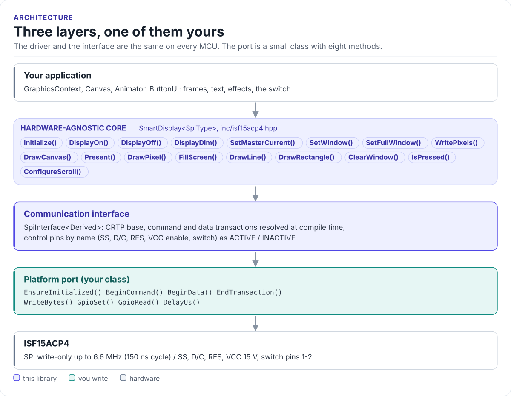

# Porting

Run the driver on a new MCU by writing one class: the SPI interface.

The driver never calls your SDK directly. It calls eight methods on a class you derive from
`isf15acp4::SpiInterface<Self>` (in [`inc/isf15acp4_spi_interface.hpp`](../inc/isf15acp4_spi_interface.hpp)). The
base class uses CRTP: the calls are resolved at compile time, so there are no virtual functions, no vtable and
nothing to allocate.

<!-- figure: driver-layers -->
<picture>
  <source media="(prefers-color-scheme: dark)" srcset="diagrams/driver-layers.dark.svg">
  
</picture>
<!-- /figure -->

## What you implement

| Method | Contract |
| --- | --- |
| `EnsureInitialized()` | Bring SPI and GPIOs up; `true` when ready, also on later calls |
| `BeginCommand()` | D/C low, then SS low: a command and its parameters follow |
| `BeginData()` | D/C high, then SS low: display data follows |
| `EndTransaction()` | SS high, after the last bit has left |
| `WriteBytes(data, len)` | Send `len` bytes (up to 12,288), blocking until sent |
| `GpioSet(pin, signal)` | Drive SS, D/C, RES or VCC enable `Active` / `Inactive`; `true` when the pin was driven (or is not wired), `false` on a GPIO error |
| `GpioRead(pin)` | `true` when `Switch` is pressed, else `false` |
| `DelayUs(us)` | Wait at least that long (the driver uses 3, 10 and 1000) |

All return `bool` except `EndTransaction()` and `DelayUs()`, which return `void`. `GpioSet()` must return `bool`
(checked at compile time): a pin the port could not drive stops `Initialize()` before the first command, with
`Error::GpioControl`, and also `Error::PowerSequence` for RES and VCC enable.

## SPI port

```cpp title="my_spi.hpp"
--8<-- "tests/docs/my_spi.hpp:port"
```

Rules the transfer must follow:

- **SPI mode 0** (mode 3 also meets the datasheet), MSB first, at most 6.6 MHz.
- **One SS-low transaction per Begin / End pair.** The driver calls `WriteBytes()` one or more times inside it (a
  command's opcode, then its parameters; a frame in chunks of up to 128 bytes); keep SS low across all of them.
- **Blocking writes.** `WriteBytes()` must not return while bytes are still queued: `EndTransaction()` raises SS
  right after it, and the display drops a byte cut short. With DMA, wait for completion.
- **No MISO.** The display has no data output; leave MISO unconnected or free for other devices.
- **Return `false` only for a bus failure.** The driver turns it into `Error::SpiWrite`.

## Control pins

The driver addresses pins by name and abstract level. Your port decides the physical level:

| Pin | Driver use | `Active` is |
| --- | --- | --- |
| `ChipSelect` | `Inactive` at start | Low |
| `DataCommand` | `Active` at start | High (data) |
| `Reset` | `Active` 3 µs, then `Inactive` | Low (RES# held in reset) |
| `VccEnable` | `Active` after reset | Supply on |
| `Switch` | Read by `IsPressed()` | Pressed |

`Reset` follows the other pins: `Active` is the asserted level, which for RES# is low. `Initialize()` drives it
`Active` for at least 3 µs, then `Inactive` (high), and waits 10 µs before the first command (SSD1331 power-on
sequence, reset completion 2 µs maximum).

## Reference implementation

The ESP32 examples use [`esp32_isf15acp4_spi_adapter.hpp`](../examples/esp32/main/esp32_isf15acp4_spi_adapter.hpp):
an ESP-IDF `spi_master` device in mode 0 with SS as a GPIO, `spi_device_polling_transmit()` for blocking writes,
an input with pull-up for the switch and `esp_rom_delay_us()` / `vTaskDelay()` for delays. Start from it for any
ESP-IDF target.

## Check your port

1. Build it: the port on this page is compiled by the host CI from [`tests/docs/`](../tests/docs/my_spi.hpp), with
   the driver instantiated over it.
2. With a logic analyser on SS, D/C and SCK, call `Initialize()`: you should see 21 command transactions (the init
   table) and two window commands, each with SS low around its bytes, and RES high at the end.
3. Call `FillScreen(isf15acp4::colors::White)`, then `FillScreen(isf15acp4::colors::Black)`: the whole panel
   turns white, then dark. (White and black do not depend on byte order; for colours see
   [Troubleshooting](troubleshooting.md#colours-wrong-after-present).)
4. Read `IsPressed()` with the button held and released.

## Threads

The driver is not thread-safe. Give each display one owner task, or guard every call on a driver object (and its
port) with one mutex. Several displays on one SPI bus need a separate SS per display, and the bus must not be used
by another device between a `Begin*()` and its `EndTransaction()`.
